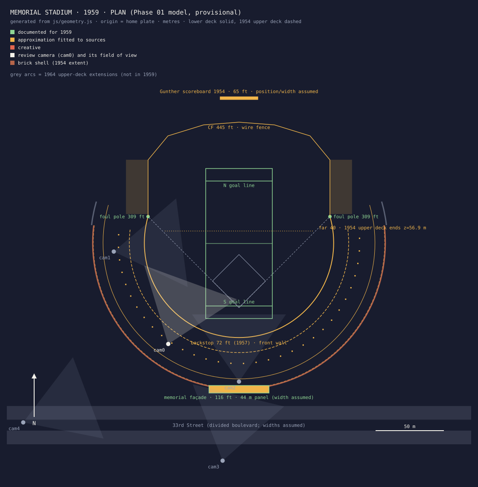
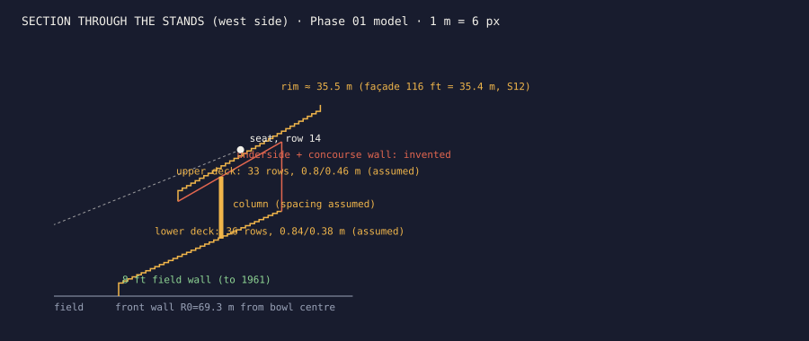

# Geometry and assumptions · MEMORIAL STADIUM 1959 · Phase 01

All numbers live in `js/geometry.js` (`DIM`). The diagrams below are generated from that file by `tests/plan.mjs`, so they cannot drift from the model.

**Frame:** origin = home plate at field level; +x east, +z north, +y up; metres. Site: 39.3294 N, 76.6014 W (S05).

## How the plan was fitted

No 1959 plan drawing has been read yet. The horseshoe comes from three dated measurements:

| constraint | value | source | status |
|---|---|---|---|
| home plate at the south, centre field due north | — | S02, S05, S10 | documented |
| backstop (home plate to the front of the stands) | 72 ft = 21.95 m (1957) | S10 | documented |
| foul poles | 309 ft = 94.2 m, so x = ±66.6 m, z = 66.6 m | S01 | documented |

One circle passes through (0, −21.95) and (±66.6, 66.6): centre z = 47.4 m, radius **R0 = 69.3 m**, reaching the poles at ±106° from due south. That circle is the lower-deck front wall. It is an approximation: the real plan may have had straight runs or compound curves.

**Cross-check (independent):** S03 says that for football the upper deck ran from the horseshoe's end zone to about the far 40. With the 1954 upper deck ending 50 ft short of the poles (the 1964 extensions added about 50 ft at each end, S02), its front edge ends at z = 56.9 m. Putting the south end line 14 m north of the backstop line (z = −8 m) puts the far 40 at z = 56.0 m. The two agree within a metre, and the resulting sideline-to-stand gap (about 45 m at the 50) matches the "well over 100 ft" complaint about football seats (S02).

Caveat: S03's football note is undated. If it describes the post-1964 deck, the gridiron sat about 14 m further north. That is review item R3.

## Sections

| element | value | basis | status |
|---|---|---|---|
| field wall | 8 ft (2.44 m) | lowered in 1961 (S01) | documented |
| lower deck | 36 rows, tread 0.84 m, riser 0.38 m → back at R0 + 30.2 m, 15.7 m up | 46 lifetime rows (S02) minus about 10 rows of 1961 boxes (S02); tread/riser assumed | approximation |
| upper deck | 33 rows, tread 0.80 m, riser 0.46 m, front at R0 + 11 m, 17.6–19.6 m up; rim 35.5 m | 33 rows (S02); "shaded most of the lower deck" (S02). The riser is set so the rim meets the documented 116 ft (35.4 m) façade (S12); the first pass used 0.50 m and put the rim 1.4 m above the wall | approximation (constrained by the façade) |
| upper-deck extent | ±96.8° (ends 15.24 m short of the poles) | 1964 extension of ~50 ft each end (S02) | approximation |
| columns | 0.9 m square, every 6°, 19 m behind the front wall | existence and obstruction documented (S02); spacing and position assumed | approximation |
| underside, fascia, concourse wall | straight soffit parallel to the rake | needed to close the section | creative |
| press box | small block on the rim behind home plate | placeholder only | creative |

## Field

| element | value | basis | status |
|---|---|---|---|
| gridiron | 160 ft × 120 yd, 10-yd end zones, lines every 5 yd, hash marks every yard 20 yd in from each sideline | NFL rules of the period (S15) | documented (dimensions) |
| gridiron position | south end line z = −8 m, on the centre line | fitted (above) | approximation |
| goalposts | H-shape on each goal line, 18 ft 6 in apart, crossbar 10 ft, uprights 25 ft | rule (S15); upright height assumed | documented / approximation |
| baseball skin | dirt arc 95 ft from the mound, infield grass, home circle, mound | standard layout; whether it was sodded over for December football is unknown | approximation |
| turf colour and wear | olive, worn between the hashes | invented to read as a winter field | creative |

Lines are 4 in wide. The ink print draws them with pixel-footprint coverage, exaggerated ×2.4 so they survive a 320-px print. This is a deliberate print-legibility choice, logged here so it isn't mistaken for evidence.

## Outfield and north end

| element | value | basis | status |
|---|---|---|---|
| corner walls | 14 ft, running due north from each pole (135° to the foul line) to z = 108 m | S01 (NYT 1954; Bready says 8 ft) and S02 | approximation |
| wing bleachers | 20 rows behind the corner walls | "lower deck extended into the outfield" / LF and RF bleachers (S01, S02); rows assumed | approximation |
| centre field | 6 ft wire fence through 446 ft (alleys) and 445 ft (CF); trees as the 1954 hedge line | S01, S02, S10 | approximation |
| scoreboard | 65 ft overall, 28 m wide, centred at z = 152 m, three legs, lamp-grid face, Longines clock disc above | height, date and clock documented (S01); width, offset and face design assumed; S03 says right-centre | approximation |
| foul poles | 20 m | position documented; height assumed | documented / approximation |

## Exterior

| element | value | basis | status |
|---|---|---|---|
| memorial façade | 116 ft (35.36 m) tall, centred on the home-plate axis, front at z = −62.5 m, 5.5 m deep | height and "ten stories" (S12); on 33rd St at the home-plate entrance (S03, S05) | height and position documented |
| façade composition | a 44 m concrete panel framed by 7 m brick pylons | "brick and stone façade" (S12), "tall concrete wall" (S03), brick (S19); the widths are assumed. The 10-ft name letters set a floor of about 42 m on the panel width | approximation |
| lettering | "MEMORIAL STADIUM" at 10 ft; the dedication at 0.62 m; the closing line at 1.15 m | text from S16 + S17 + S12; name on the sign (S18); sizes inside the documented 12 in – 10 ft range (S12); the bitmap letterforms are not the originals (the closing line's letters were wider and rounder, S20) | text documented; sizes and forms approximate |
| city seal | plain disc 5.4 m across, centred below the name | existence documented (S12); size, position and the seal's artwork are not drawn | approximation |
| entrance gates | seven openings, 3.2 m × 4.6 m, at a 5.6 m pitch | the home-plate entrance is documented (S03, S16); the gate rhythm is invented | creative |
| brick shell | vertical wall round the 1954 horseshoe, 0.4 m outside the upper deck back, full height to the rim; lower outside the decks' open ends and the wings | "massive brick exterior wall" (S02), reddish-brown (S03), Baltimore brick (S19) | approximation |
| shell articulation | concrete band at 16.6–17.9 m and coping at the rim, two rows of vents, ground portals every 12° | invented to give the wall scale | creative (claim 23 note) |
| external ramps | not modelled | most were "additional" ramps added round the periphery by the 1970s (S02) | — |
| entrance plaza | paving between the façade and 33rd St | plaza finished in 1954 (S05); extent assumed | approximation |
| 33rd Street | divided boulevard: 10 m carriageways either side of an 8 m grass median, north edge 9.5 m south of the façade; no median trees drawn | "33rd Street boulevard/parkway" (S05); widths and offsets assumed | approximation |
| Ellerslie Ave / Ednor Rd / 36th St | 12 m streets at x = −150 m, x = +150 m and z = 200 m | sides documented (S05); positions not traced | approximation |
| neighbourhood | generic two-storey rowhouse terraces and bare street trees on every side | creative | creative |

## Not modelled (on purpose)

- **Light towers.** S02 says big towers came "later in the 1950s", but no date or positions yet, and it was a day game (claim 20).
- **Players, officials, benches, flags, field-level "field seats" (S14), scoreboard content.** These wait for MZ.Human to choose a moment and for period photographs.
- **Real ground levels** outside the bowl.

## Camera stations

| id | where | aim | FOV |
|---|---|---|---|
| **cam0 `sw-upper`** (review view) | upper deck, third-base curve (θ = −35°), row 12, eye 1.15 m above the tread: (−51.8, 26.8, −26.6) | yaw 20° (NNE), pitch −15° | 74° horizontal |
| cam1 `w-upper-50` | west upper deck, row 14, near the 50 | east across the field | 66° |
| cam2 `home-rim` | upper deck behind home plate, row 26 | due north up the horseshoe | 70° |
| cam3 `33rd-street` | south side of 33rd Street, eye 1.6 m, 50 m from the façade | up at the memorial wall | 70° |
| cam4 `ellerslie` | corner of 33rd St and Ellerslie Ave | east along the façade and the brick shell | 64° |
| cam5 `overview-se` | 175 m up, south-east of the site (a model view, not a 1959 vantage) | the whole bowl in its blocks | 46° |

Scene sun (15:10 EST, 27 Dec 1959): elevation 14.2°, azimuth 222.6° (SW), from the NOAA approximation shared with 046/047.
